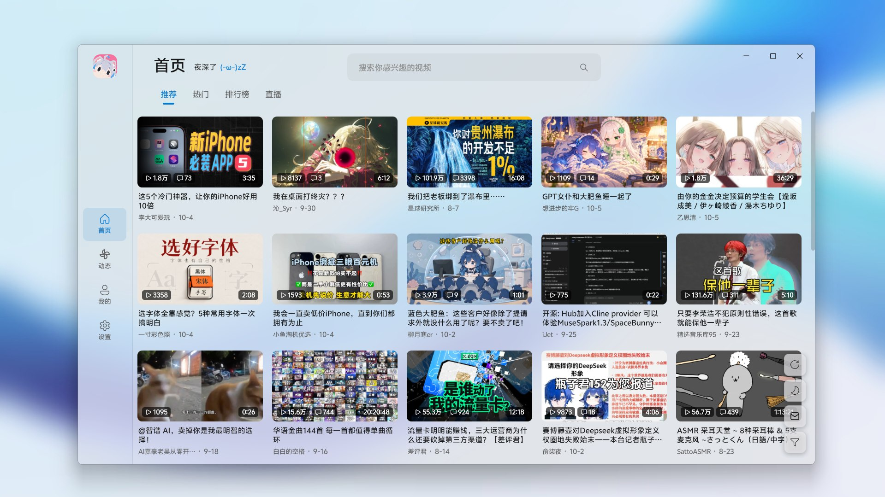

# BiliDesk

哔哩哔哩第三方客户端。一套 Compose Multiplatform 代码覆盖 Android、Windows、macOS 和 Linux。

- Android：Compose / Media3
- 桌面：Compose / LibVLC（需要本机已安装 VLC）




> 非官方、非商业的开源项目，与哔哩哔哩官方无任何关联。视频内容与版权归哔哩哔哩所有。

## 下载

前往 [Releases](https://github.com/ABING1111/BiliDesk/releases/latest) 下载最新版本。

## 功能

- 视频播放：DASH 音视频双流，最高 4K，HEVC 优先。桌面用 LibVLC，Android 用 Media3
- 播放设置：默认画质可预选（该清晰度不可用时自动降级），线路自动测速，免登录 1080P
- 弹幕：滚动/顶部/底部，智能屏蔽、关键词黑名单、彩色开关、显示区域
- SponsorBlock 跳过赞助片段（默认关闭）
- 登录（扫码）、历史（视频/直播）/收藏/稍后再看/动态/消息、分区浏览、搜索（可粘贴 BV / 空间 / 直播链接）
- 桌面端：系统托盘、关闭到托盘、单实例、播放器快捷键
- 亮色/暗色/跟随系统

## 构建

需要 JDK 17+ 和 Android SDK；Compose 桌面端另外需要本机的 VLC：

```bash
./gradlew :androidApp:assembleDebug
./gradlew :desktopApp:run
```

打包桌面安装包：

```bash
./gradlew :desktopApp:package
```

## 许可

[GPL-3.0](LICENSE)
